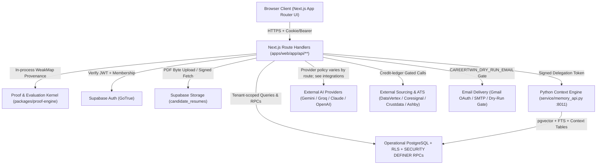
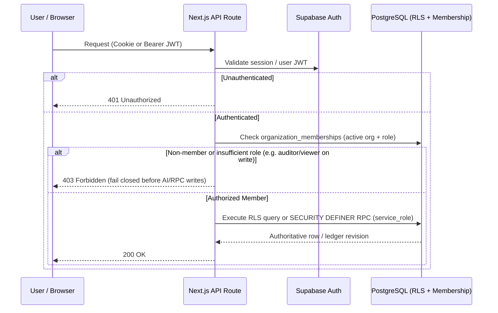
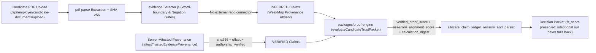
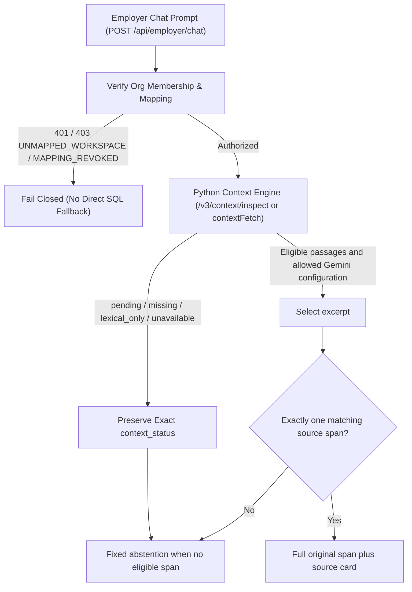
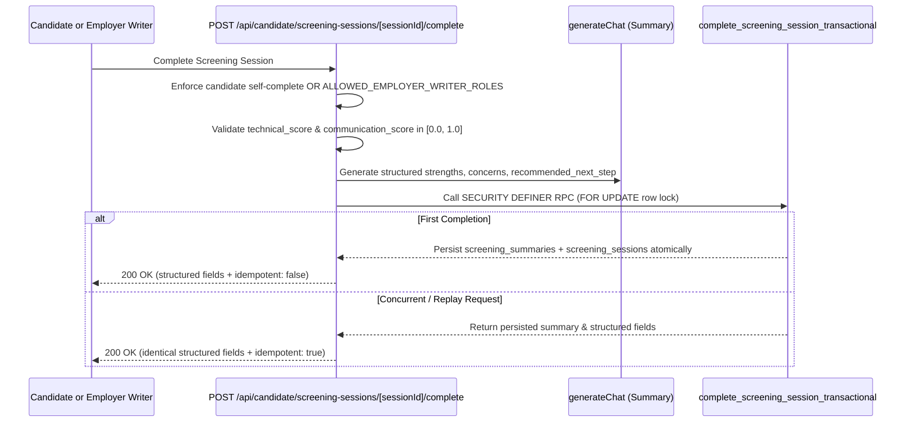
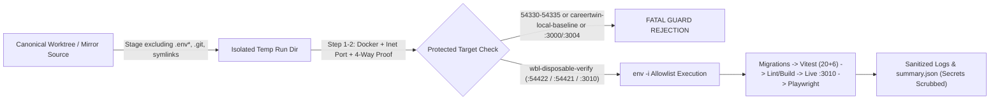

# workBYLiNE — System Architecture & Trust Boundaries (`ARCHITECTURE.md`)

**v5 review candidate — local engineering review only.** This is a delta from the v4 Parth archive, not a clean checkout of its base commit. The v4 guarded run and production-build counts below are historical, not v5 executions. Current evidence and remaining gates: [v5 review record](../../V5_REVIEW.md).

**Lifecycle Status:** `IMPLEMENTED PENDING INDEPENDENT REVIEW`  
**Base Commit:** `68fb5f443dd20585670ed3f5c5a06ff4e8dc30f1`

---

## 1. High-Level System Topology

---

## 2. Authentication, Membership & Tenant Isolation Flow

---

## 3. Candidate Evidence, Provenance & Evaluation Pipeline

---

## 4. Employer Grounded Chat & Abstention Validation Flow

---

## 5. Screening Session Completion & Concurrency Transaction Flow

---

## 6. Guarded Disposable Verification & Secret-Boundary Architecture

---

## 7. Material Component Inventory

| Component | Path | Purpose | Status Tag |
|---|---|---|---|
| Web App & API | `apps/web/app/**` | Next.js 16 App Router UI + 50 API route handlers | `TEST-VERIFIED` (disposable + mocked) |
| Proof Engine | `packages/proof-engine/src/**` | Deterministic scoring, `WeakMap` provenance, `calculation_digest` | `TEST-VERIFIED` |
| Grounding Validator | `apps/web/lib/chatGrounding.js` | Clause-level polarity, entity, numeric, scope, and refusal-bypass validator | `TEST-VERIFIED` |
| Screening Completion | `apps/web/app/api/candidate/screening-sessions/[sessionId]/complete/route.js` | Role-gated, transactional screening completion + replay | `TEST-VERIFIED` |
| Context Engine | `service/memory_api.py`, `service/core.py` | FastAPI context ingestion, FTS/hybrid retrieval, grounding inspection | `OBSERVED` / `TEST-VERIFIED` (PG17 FTS; Temporal CLI & BGE weights `NOT VERIFIED` locally) |
| Guarded Harness | `scripts/guarded_disposable_verify.sh` | Isolated disposable verification runner with secret scrubbing | `VERIFIED` |
